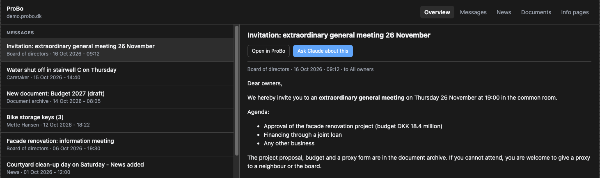

<p align="center">
  
</p>

<h1 align="center">probo-mcp</h1>

<p align="center">
  A read-only <a href="https://modelcontextprotocol.io">MCP</a> server for <a href="https://probo.dk">EG ProBo</a> owners' association portals.<br>
  Ask Claude what's new, summarise meeting papers, search the document archive, or browse it all in the chat.
</p>

<p align="center">
  <a href="https://github.com/kiliantscherny/probo-mcp/actions/workflows/ci.yml"></a>
  <a href="https://kiliantscherny.github.io/probo-mcp/"></a>
  
  
  <a href="LICENSE"></a>
</p>

<p align="center"></p>

**[📖 Documentation](https://kiliantscherny.github.io/probo-mcp/)** ·
[Claude Desktop](https://kiliantscherny.github.io/probo-mcp/get-started/claude-desktop/) ·
[Claude Code](https://kiliantscherny.github.io/probo-mcp/get-started/claude-code/) ·
[How it works](https://kiliantscherny.github.io/probo-mcp/how-it-works/) ·
[MCP 2.0 showcase](https://kiliantscherny.github.io/probo-mcp/mcp-showcase/)

## Features

- **Messages, news, documents and info pages** as tools with structured output, plus `probo://` resources with argument completion.
- **Search the whole document archive** by upload date or name, with progress updates, and read PDFs as text. Scanned PDFs come back as page images that Claude reads itself.
- **An interactive ProBo browser** (an MCP App) right inside Claude Desktop.
- **"What's new" that remembers**: new messages, news and documents are fetched in full and saved to a local archive, so the next time you ask you only get what has changed.
- **A complete local archive**: `fetch_history` (or `probo-mcp --fetch-history`) saves all past news and the whole document archive as Markdown, PDFs and text.
- **Prompts** for "what's new", summarising a document, and preparing for the general meeting.
- **Read-only by construction**: an allowlist of routes is checked before every request, and the only thing ever submitted is the login form.
- **Your password stays out of reach**: kept in the system keychain (`probo-mcp --set-password`; on macOS every read needs your approval) or 1Password, never in config files. The login only ever goes to a `*.probo.dk` site.
- **Safe over HTTP too**: it only listens on this computer unless you pass `--allow-remote`, which requires a bearer token.
- **One-click Claude Desktop extension** (`.mcpb`).

## Quick start

**Claude Desktop:** download the `.mcpb` from the [latest release](https://github.com/kiliantscherny/probo-mcp/releases/latest), double-click it, and enter your ProBo address and e-mail. Leave the password empty and save it in the keychain instead (below).

**Claude Code:**

```sh
# once, in your own terminal (not through Claude): save the password in the system keychain
uvx --from git+https://github.com/kiliantscherny/probo-mcp probo-mcp --set-password

claude mcp add probo -s user \
  -e PROBO_BASE_URL=https://<association>.probo.dk \
  -e PROBO_USERNAME=you@example.com \
  -- uvx --from git+https://github.com/kiliantscherny/probo-mcp probo-mcp
```

Using 1Password? Add `-e PROBO_PASSWORD='op://Private/ProBo/password'` instead of saving to the keychain; the server resolves it itself. See [Your password](https://kiliantscherny.github.io/probo-mcp/configuration/#your-password).

Then ask: *"What's new in ProBo?"*, or in Danish, *"hvad er nyt i ejerforeningen?"*

## Development

```sh
uv sync
uv run tox                           # tests on 3.12–3.14, ruff, ty, docs
uv run --group docs zensical serve   # preview the docs
```

To release, bump `version` in `pyproject.toml` and push a matching `v<version>` tag. The release
workflow tests and builds the wheel and the `.mcpb`, and publishes them with `SHA256SUMS`.

See the [development guide](https://kiliantscherny.github.io/probo-mcp/development/).

---

Unofficial; not affiliated with or endorsed by EG A/S. It reads the same pages you see in your browser,
so a ProBo redesign can temporarily break individual tools.
