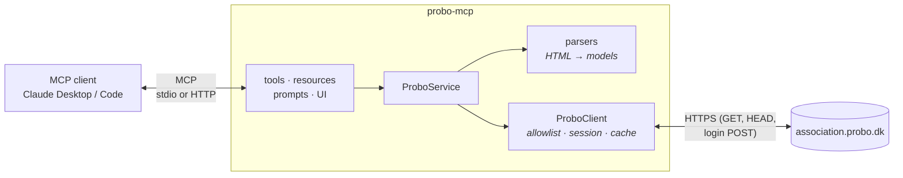

# How it works

ProBo has no public API. It's a server-rendered Django application that uses
[HTMX](https://htmx.org) for its lists. probo-mcp logs in the way your browser does, fetches the same
pages, and turns the HTML into structured data.

| Layer | Module | Responsibility |
|---|---|---|
| MCP | `server.py`, `tools.py`, `resources.py`, `prompts.py`, `ui/` | Protocol surface: schemas, annotations, errors, progress, elicitation, completions. |
| Service | `service.py` | ProBo operations (list, read, search the archive, extract text), plus browser URLs. Knows nothing about MCP. |
| Parsers | `parsers.py` | Pure functions from HTML to Pydantic models, with no I/O. Tested against synthetic fixtures. |
| Client | `client.py` | Login, session renewal, the read-only allowlist, a short TTL cache. |

## The ProBo side

- **Lists are HTMX partials.** A `GET` with the header `HX-Request: true` returns just the rows. They
  follow Django-admin changelist conventions: `?p=N` pages (1-based; an empty page means the end),
  `?q=` searches, and table cells are `td.field-<name>`.
- **Login** is a standard Django form: `GET /member/login/` sets a `csrftoken` cookie, and the form is
  posted back with that token and a matching `Referer`. When the session expires, pages redirect to the
  login page. The client notices, logs in again (once, behind a lock) and retries.
- **Files** download from `/member/download_file/<area>/<model>/<uuid>/` with a
  `Content-Disposition` filename.

## Read-only, structurally

"Read-only" isn't a convention the code tries to follow. It's built into what the client can do:

1. The client's only public methods are `get_html`, `file_info` (HEAD) and `download` (GET).
2. Each checks the path against an **allowlist** of anchored regular expressions *before* any network
   request. Message threads, news posts, archive folders, info pages and file downloads are allowed,
   and nothing else.
3. The only `POST` is the login form, and it's private to the client.

This matters because ProBo has plain links that change state when visited. For example,
`/member/communication/message/toggle_subscription/<id>/` turns off notifications for a thread.
probo-mcp never follows URLs found in page content. Ids from the model are validated as UUIDs, and
attachment paths are checked against the download allowlist. The tests check that disallowed paths
are refused without any request being made.

## Caching

- **Inside the server:** fetched pages are reused for `PROBO_CACHE_SECONDS` (60 s), keyed by path,
  query and HTMX flag. That keeps the interactive browser and completions fast.
- **For clients:** the server publishes cache hints (SEP-2549). `tools/list`, `prompts/list` and
  `resources/templates/list` can be cached publicly for an hour. `resources/read` can be cached
  privately for a minute, because it holds per-user content.

## When ProBo changes

Because this works by reading HTML, a ProBo redesign can break a parser. The selectors are all in
`parsers.py`, which has tests against fixtures that mirror ProBo's markup. Each fixture records the
class names the parser depends on, so a breakage is quick to find.
