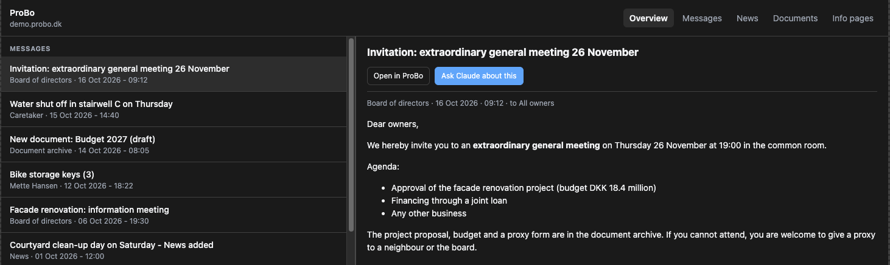

# probo-mcp

<p class="hero-tagline">Ask Claude what's going on in your owners' association.</p>

**probo-mcp** is a read-only [Model Context Protocol](https://modelcontextprotocol.io) server for
[EG ProBo](https://probo.dk), the portal Danish owners' associations (*ejerforeninger*), housing co-ops
(*andelsboligforeninger*) and property administrators use to talk to residents.

Connect it to Claude Desktop, Claude Code or any MCP client, and ask things like:

- *"What's new in ProBo this week?"*
- *"Summarise the documents for the general meeting and tell me what it costs me."*
- *"Find every document about the roof project."*
- *"Show me the ProBo browser."* :material-arrow-right: an interactive browser opens in the chat.

{ .screenshot }

<div class="grid cards" markdown>

-   :material-download-circle-outline:{ .lg .middle } **One-click install for Claude Desktop**

    ---

    Download the `.mcpb` extension, double-click it, and enter your ProBo address and login.

    [:octicons-arrow-right-24: Claude Desktop](get-started/claude-desktop.md)

-   :material-shield-lock-outline:{ .lg .middle } **Read-only by construction**

    ---

    The client can only fetch an allowlist of read-only routes, and the only thing it ever submits is the login form.
    It never sends messages, changes settings or deletes anything.

    [:octicons-arrow-right-24: How it works](how-it-works.md)

-   :material-file-search-outline:{ .lg .middle } **Documents, not just links**

    ---

    Walks the whole document archive with progress updates and extracts the text from PDFs, so Claude can
    read the meeting papers rather than just list them.

    [:octicons-arrow-right-24: Tools](features/tools.md)

-   :material-puzzle-outline:{ .lg .middle } **A tour of MCP 2.0**

    ---

    Structured output, resources with completion, prompts, progress, elicitation, an MCP App UI and cache hints,
    each tested on both protocol eras.

    [:octicons-arrow-right-24: MCP 2.0 showcase](mcp-showcase.md)

</div>

!!! note "Unofficial"
    This project is not affiliated with or endorsed by EG A/S. It works by reading the same pages
    you see in your browser, so a ProBo redesign can temporarily break individual tools.
    ProBo has a "Forbundne apps" (connected apps) page, which suggests an official integration
    may be on its way.

## Quick start

=== "Claude Desktop"

    1. Download `probo-mcp-<version>.mcpb` from the [latest release](https://github.com/kiliantscherny/probo-mcp/releases/latest).
    2. Double-click it (or drag it onto Claude Desktop) and click **Install**.
    3. Enter your ProBo address (`https://<association>.probo.dk`), e-mail and password.

=== "Claude Code"

    ```sh
    claude mcp add probo -s user \
      -e PROBO_BASE_URL=https://<association>.probo.dk \
      -e PROBO_USERNAME=you@example.com \
      -e PROBO_PASSWORD=op://Private/ProBo/password \
      -- uvx --from git+https://github.com/kiliantscherny/probo-mcp probo-mcp
    ```

=== "Any MCP client"

    ```json
    {
      "mcpServers": {
        "probo": {
          "command": "uvx",
          "args": ["--from", "git+https://github.com/kiliantscherny/probo-mcp", "probo-mcp"],
          "env": {
            "PROBO_BASE_URL": "https://<association>.probo.dk",
            "PROBO_USERNAME": "you@example.com",
            "PROBO_PASSWORD": "..."
          }
        }
      }
    }
    ```

Passwords can be [1Password references](configuration.md#1password) (`op://vault/item/password`), so
the secret never has to sit in a config file.
